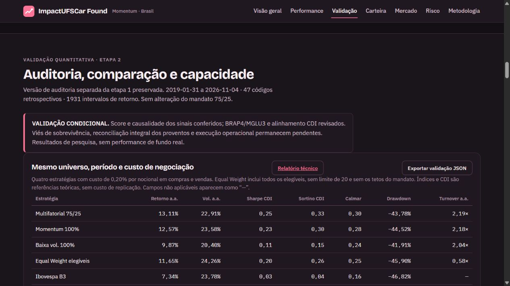

# ImpactUFSCar Found

Plataforma de pesquisa quantitativa da ImpactUFSCar: backtest de ações brasileiras,
auditoria de dados, comparação de fatores e dashboard interativo.

**Status científico: validação condicional.** O universo é retrospectivo e tem viés
de sobrevivência. Os resultados são de uma carteira fictícia, sem fundo constituído,
captação, oferta ou ordens reais. Não constituem alpha validado.

## Comece aqui

| Objetivo | Onde começar |
|---|---|
| Sou trainee e quero entender o projeto | [Guia dos trainees](docs/GUIA_TRAINEES.md) |
| Quero instalar e executar | [Instalação e reprodução](docs/REPRODUCAO.md) |
| Quero entender os fatores e a execução | [Metodologia](docs/METODOLOGIA.md) |
| Quero saber o que faz cada módulo | [Arquitetura](docs/ARQUITETURA.md) |
| Quero conferir os resultados e pendências | [Relatório técnico da etapa 2](output/validacao_etapa2/RELATORIO_TECNICO.md) |
| Quero os arquivos de pesquisa completos | [Releases](https://github.com/rafaelferreirabsantos-cyber/impact-found/releases) e [catálogo dos dados](docs/DADOS_E_FONTES.md) |
| Quero contribuir | [CONTRIBUTING](CONTRIBUTING.md) e [backlog](docs/BACKLOG.md) |



## Executar em poucos passos

Python **3.11 ou superior** e Git. Os comandos abaixo devem ser executados na raiz
do repositório. O ambiente de referência original usou Python 3.13.

```shell
git clone https://github.com/rafaelferreirabsantos-cyber/impact-found.git
cd impact-found
python -m venv .venv
```

Ative o ambiente no Windows: `.venv\Scripts\activate`. No Linux/macOS:
`source .venv/bin/activate`. Depois:

```shell
python -m pip install -r requirements-validation.txt
python -m unittest discover -s tests -v
python -m src.market_server --provider brapi --refresh-min 30
```

Abra **http://127.0.0.1:8765/**. O dashboard com resultados congelados já acompanha
o repositório. O monitor de mercado é separado da pesquisa histórica; sem
`BRAPI_TOKEN`, a cobertura de cotações é limitada e o PL indicativo pode ficar
bloqueado. Nunca coloque tokens em HTML, notebooks ou commits.

Para reproduzir os cálculos com todos os caches da amostra publicada:

```shell
python scripts/research_data.py --download-research
python -m src.validation_audit
python -m src.validation
python tests/validate_stage2_real.py
python -m src.validation_report
```

O download verifica SHA-256 e restaura os diretórios esperados. Ele recusa
sobrescrever arquivos diferentes sem uma opção explícita de backup. Os ZIPs
anuais completos da B3 são opcionais e separados; consulte o guia de dados.

## Mandato preservado

- Patrimônio inicial fictício: R$ 100 milhões.
- Momentum 12–1: 75% do percentil; baixa volatilidade: 25% do percentil inverso.
- Até 20 ações; pesos-alvo iguais de 5%; máximo de 30% por setor e 5% por emissor
  na formação. Os pesos podem derivar entre formações.
- Rebalanceamento mensal. Sinal após o último fechamento do mês e execução
  modelada no fechamento do pregão seguinte.
- Custo-base de 0,20% do nocional em cada compra/venda. Caixa remunerado pelo CDI.
- Sem venda a descoberto, futuros ou alavancagem.

## O que foi calculado

Amostra de PL: **31/01/2019 a 04/11/2026**, após aquecimento iniciado em 2018.
São 94 rebalanceamentos e 47 códigos com dados ajustados disponíveis, de 51
configurados. As quatro séries ausentes foram investigadas; seus preços brutos
foram recuperados na B3, sem serem tratados como retorno total validado.

| Referência | Retorno anualizado da etapa 2 | Máximo drawdown |
|---|---:|---:|
| Multifatorial 75/25 | 13,11% | −43,78% |
| Momentum puro | 12,57% | −44,52% |
| Baixa volatilidade pura | 9,87% | −41,91% |
| Equal Weight dos elegíveis | 11,65% | −45,90% |
| Ibovespa B3 | 7,34% | −46,82% |
| IBrX 100 B3 | 7,58% | −46,73% |
| CDI | 9,72% | 0,00% |

As quatro carteiras usam o mesmo período e custo de 20 bps por nocional. Equal
Weight inclui todos os elegíveis e não é uma carteira aderente ao limite de 20.
Índices/CDI são referências teóricas sem custo de replicação. O relatório detalha
as convenções, os intervalos de incerteza e as métricas de risco.

**Limitações que não podem ser omitidas:** proventos não integralmente
reconstruídos por data de pagamento; composição/sectores retrospectivos;
capacidade de R$ 100 milhões não comprovada; slippage e taxas são hipóteses.
123 ordens superaram 10% do ADV. No cenário hipotético de slippage η=0,5 e taxas
2%/20%, o retorno líquido anualizado foi 9,16%. Nenhuma configuração foi escolhida
para maximizar o histórico. O acompanhamento prospectivo está preparado, com
registros futuros vazios na amostra publicada.

## Organização

```text
src/          motor, fontes, auditorias, validação, relatórios e servidor
tests/        testes unitários e conferências independentes dos cálculos reais
config/       universo, template PIT e protocolo quantitativo congelado
dashboard/    template visual e painel de validação, preservando a identidade
notebooks/    material didático original
docs/         onboarding, arquitetura, método, dados, backlog e documentos antigos
scripts/      download/restauração com hashes e verificação do repositório
data/         inventários, manifesto dos assets e ambiente de referência
output/       dashboard e resultados de referência selecionados
.github/      integração contínua, modelos de tarefa e de pull request
```

Os caches completos, cenários detalhados, logs e snapshot da etapa 1 ficam no
pacote de pesquisa da Release. Originais grandes da B3 ficam em assets separados.
PDFs e outros materiais de terceiros são referenciados por URL e hash; ambientes
virtuais e caches de bibliotecas não entram no Git. Nada foi removido da pasta
original de trabalho. [Inventário completo](data/INVENTARIO_ORIGINAL.json).

## Colaboração

Use branches curtas, uma tarefa por pull request e revisão antes de integrar.
Não sobrescreva a amostra congelada ao fazer experimentos. Identifique mudanças
de dados, metodologia, parâmetros e interface separadamente na descrição do PR.
Trainees podem clonar/forkar o repositório público e enviar pull requests; acesso
direto de escrita depende de convite do responsável.

A licença aberta do código ainda não foi definida pelos responsáveis.
[Direitos e atribuições](NOTICE.md). As condições dos provedores de dados
permanecem aplicáveis aos seus respectivos materiais.
