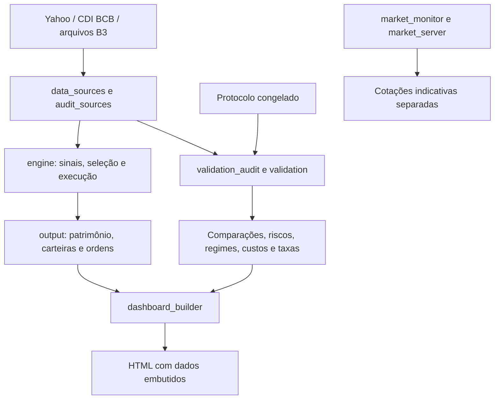

# Arquitetura

| Módulo | Responsabilidade |
|---|---|
| `src/data_sources.py` | Leitura e coleta de preços ajustados, CDI SGS 12 e benchmark |
| `src/audit_sources.py` | Conferência COTAHIST, calendário e correção documentada de UGPA3 |
| `src/engine.py` | Parâmetros, elegibilidade, percentis, seleção, execução, custos e exportação |
| `src/run.py` | CLI histórico; coleta/cache, simulação e geração do HTML |
| `src/validation_data.py` | Índices oficiais B3 e histórico bruto dos códigos antigos |
| `src/validation_audit.py` | Conferência independente do score e dos eventos revistos |
| `src/validation.py` | Estratégias alternativas, risco, regimes, sensibilidade, capacidade e taxas |
| `src/validation_report.py` | Figuras, relatório técnico, plano prospectivo e dashboard |
| `src/dashboard_builder.py` | Empacotamento dos JSONs no template e painel de validação |
| `src/market_monitor.py` | Cotações e valorização indicativa, sem execução de ordens |
| `src/market_server.py` | Servidor local e endpoint `/api/market` |

## Separações importantes

O monitor não recalcula nem substitui o backtest. Uma captura de cotação não é
fechamento histórico ajustado. Um resultado de simulação não é cota de fundo.

O template `dashboard/index.html` contém marcadores de dados. O construtor gera
HTML autônomo com os JSONs embutidos. `validation-panel.html/js` são fontes do
painel, sem trocar a folha de estilo base. O servidor prefere o HTML com
resultados quando ele existe.

O protocolo em `config/validacao_etapa2_protocolo.json` é a referência congelada.
Não deve ser reescrito para experimentar novos pesos. Experimentos novos precisam
de configuração e saída próprias, com critério registrado antecipadamente.

## Testes

`test_engine.py` e `test_validation.py` usam fixtures artificiais apenas nos
testes. `validate_real_run.py` confere a primeira execução; `validate_stage2_real.py`
confere os cálculos reais da segunda etapa e a preservação dos arquivos antigos.
Os dois últimos exigem o pacote de pesquisa completo, inclusive o snapshot.

Os formatos legados foram preservados para rastreabilidade. O parâmetro legado
`ending_date` do motor reproduz o alinhamento antigo; novos cálculos da etapa 2
usam explicitamente `starting_date`. Veja a justificativa no relatório.
