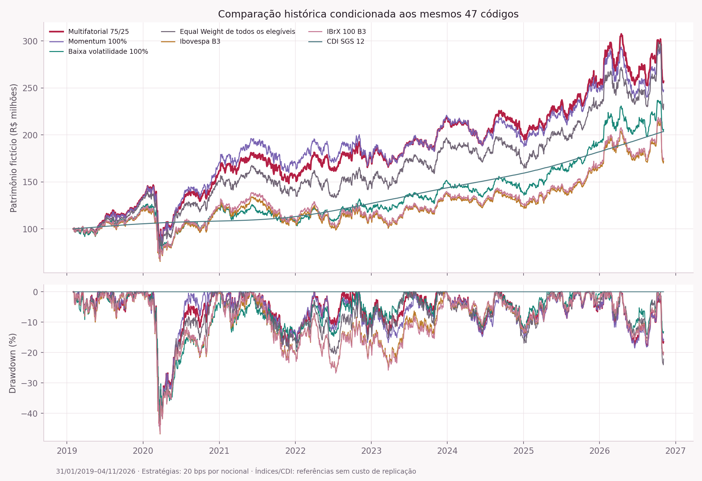
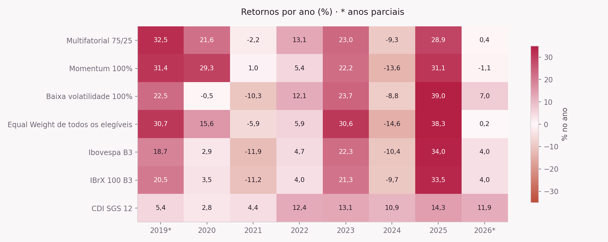
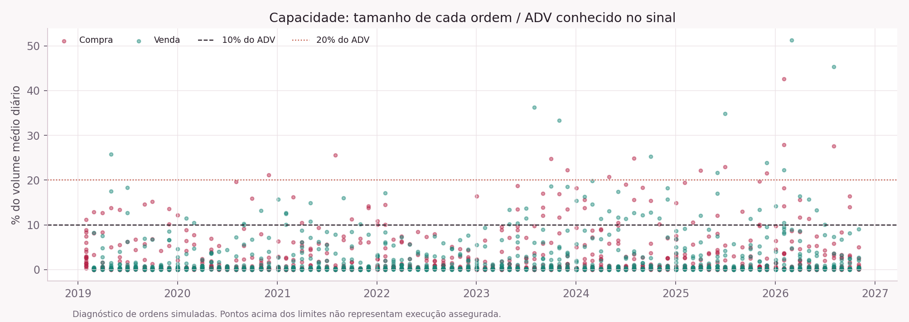
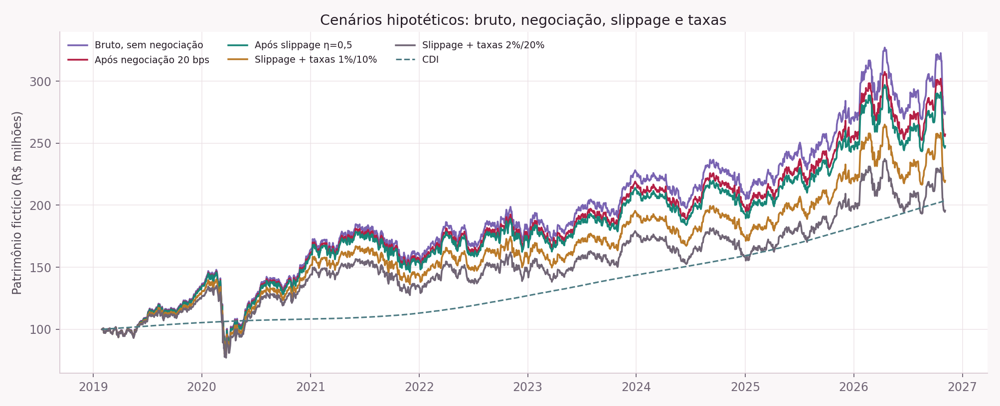

# ImpactUFSCar Found — segunda etapa de validação quantitativa

**Data do relatório: 05/11/2026. Corte dos dados: 04/11/2026. Status: CONDICIONAL.**

Este documento apresenta pesquisa de uma carteira fictícia. Não apresenta desempenho de fundo real, alpha validado ou capacidade de execução assegurada. As comparações usam os mesmos 47 códigos disponíveis, período de patrimônio de 31/01/2019 a 04/11/2026 e custos idênticos entre as quatro estratégias. Nenhum preço foi inventado para preencher histórico.

## 1. Conclusão sustentada pelos dados

O algoritmo do score 75/25 e a separação entre decisão e execução foram conferidos. A auditoria identificou e tratou diferenças econômicas em BRAP4/MGLU3 e corrigiu o alinhamento do CDI. Após essas revisões, o multifatorial apresenta retorno anualizado de **13,11%**, volatilidade de **22,91%**, Sharpe sobre CDI de **0,25** e drawdown de **-43,78%**. Seu PL final fictício é **R$ 257.086.841,07**.

O multifatorial teve resultado pontual superior às outras três carteiras nesta amostra. Entretanto, os intervalos de incerteza incluem zero na comparação com Momentum puro, baixa volatilidade, Equal Weight e CDI. A comparação com os índices oficiais é positiva no intervalo estatístico empregado, mas continua condicionada ao universo retrospectivo, às hipóteses de dados, às múltiplas comparações e ao método de reamostragem. Isso não sustenta uma afirmação de alpha.

A viabilidade de execução integral com R$ 100 milhões iniciais **não foi comprovada**: 123 de 2161 ordens excedem 10% do ADV. Com slippage hipotético e taxas de 2%/20%, o retorno anualizado líquido cai para **9,16%**, frente a **9,72%** do CDI. O cenário de 1%/10% permanece acima do CDI nesta amostra, sem comprovação prospectiva. Não foi alterado o mandato nem escolhida retrospectivamente uma configuração vencedora.

## 2. Preservação, protocolo e amostra

Antes das alterações, foram preservados o código, o template, a configuração e todos os resultados da etapa 1 em `work/etapa2/etapa1_antes_da_auditoria.zip`. Os CSVs de entrada, JSON histórico, patrimônio, seleções, ordens e métricas originais permaneceram byte a byte iguais, conforme `validacao_independente.json`. O HTML original foi preservado como `output/dashboard_com_resultados_etapa1.html`; o endereço atual recebeu a nova seção, mantendo as seções anteriores e a identidade visual.

O protocolo foi registrado antes das comparações: `protocolo_registrado.json`, SHA-256 **`16663050dae5a4dbd1bcf31a5460aea988333ec3627f1c2d80f29caa5a65626b`**. A seleção principal permaneceu Momentum 12–1 75% + baixa volatilidade 25%, até 20 nomes, pesos nominais 5%, teto setorial 30%, teto de emissor 5%, ADV21 mínimo de R$ 33.333.334 e custos de 20 bps por nocional em compras e vendas.

Os preços começam em 02/01/2018, usados no aquecimento; o PL começa no fechamento de 31/01/2019 e as primeiras ordens são executadas em 01/02/2019. São 1.932 fechamentos, 1.931 intervalos de retorno e 94 rebalanceamentos. As três carteiras por score tiveram 20 ativos em todas as formações. O comparador Equal Weight inclui todos os elegíveis, em média 43,88; não é carteira aderente ao limite de 20 ou aos tetos de emissor/setor. Seu teto de emissor observado foi 5,88%.

## 3. Auditoria dos dados e eventos societários

### 3.1 Universo retrospectivo e quatro séries ausentes

| Código | Primeiro preço B3 na janela | Último preço B3 | Observações |
|---|---|---|---|
| BRFS3 | 2018-01-02 | 2025-09-22 | 1920 |
| CPLE6 | 2018-01-02 | 2025-11-07 | 1954 |
| JBSS3 | 2018-01-02 | 2025-06-06 | 1845 |
| MRFG3 | 2018-01-02 | 2025-09-22 | 1920 |

Esses preços brutos foram recuperados diretamente dos arquivos anuais COTAHIST B3. Logo, os quatro códigos tinham histórico; sua ausência no Yahoo não autoriza excluí-los de um universo historicamente neutro. O CSV `historico_codigos_ausentes_b3.csv` preserva preços, volume financeiro e ISIN, mas **não foi usado como substituto de retorno total**.

- **CPLE6:** sequência de unificação das preferenciais e conversão em ordinárias CPLE3. O aviso da Copel de 17/11/2025 detalha conversão e resgate; a preferência passa por CPLE5 e envolve parcela em dinheiro de R$ 0,7749. Copel já está representada por CPLE3 no universo; simplesmente duplicar a série criaria dupla contagem de emissor e ignoraria os direitos próprios de cada classe. [Aviso original arquivado na CVM](https://www.rad.cvm.gov.br/ENET/frmDownloadDocumento.aspx?Tela=ext&descTipo=IPE&CodigoInstituicao=1&numProtocolo=1446410&numSequencia=971122&numVersao=1).
- **BRFS3 e MRFG3:** a reorganização retira BRFS3 e altera MRFG3 para MBRF3; a série oficial mostra término dos dois códigos antigos em 22/09/2025 e início de MBRF3 em 23/09/2025. São necessárias relação de troca, eventuais pagamentos e política de posição, não uma substituição textual. [Comunicado oficial B3](https://sistemasweb.b3.com.br/PlantaoNoticias/Noticias/Detail?agencia=15&dataNoticia=2025-09-18+05%3A27%3A40&idNoticia=3073281).
- **JBSS3:** encerra negociação em 06/06/2025 e é sucedido pela estrutura de BDR JBSS32 a partir de 09/06/2025. A mudança envolve incorporação/resgate e frações; o novo instrumento é BDR, exigindo decisão de mandato. [Fato relevante original JBS de 06/06/2025](https://www.rad.cvm.gov.br/ENET/frmDownloadDocumento.aspx?Tela=ext&descTipo=IPE&CodigoInstituicao=1&numProtocolo=1387922&numSequencia=912634&numVersao=1).

**O viés de sobrevivência não foi eliminado nem quantificado com precisão.** Faltam composição histórica completa do universo, emissores que desapareceram e séries total return verificadas. Setores e identidades de emissor também são retrospectivos. Não é válido atribuir às quatro séries retorno zero, assumir caixa no período inteiro ou completar cotações com dados sintéticos. As comparações abaixo são condicionais ao mesmo subconjunto de 47 séries.

### 3.2 BRAP4 e MGLU3: preço versus riqueza econômica

| Evento | Retorno da etapa 1 | Retorno independente | Tratamento |
|---|---|---|---|
| BRAP4 · 2021-12-17 | 0,61% | -0,51% | CORRIGIDO: marcação econômica de ação e direitos a receber; sem simulação de custódia e pagamento |
| MGLU3 · 2024-02-01 | 4,88% | -0,99% | CORRIGIDO: ação + direito marcado a mercado; não pressupõe exercício ou venda assegurada |
| BRAP4 · 2021-09-21 | 0,67% | 0,67% | RECONCILIADO |
| MGLU3 · 2024-05-27 | -0,38% | -0,38% | RECONCILIADO |
| MGLU3 · 2025-12-30 | 0,40% | 0,40% | RECONCILIADO |

**BRAP4, 17/12/2021:** o fechamento bruto cai de R$ 55,78 para R$ 23,14. O acionista também passa a ter direito a 0,332373453 ação VALE3 por ação BRAP4, mais R$ 6,043850916 de dividendo. Com VALE3 a R$ 79,17 no fechamento ex-direito, a riqueza econômica é `(23,14 + 0,332373453 × 79,17 + 6,043850916) / 55,78 − 1`, cerca de −0,51%. A etapa 1 indicava +0,61% no retorno ajustado. A correção encadeia esse retorno econômico e preserva os demais retornos diários.

As ações Vale são creditadas em 20/12 e o dinheiro em 29/12; entre ex-direito e pagamento, são direitos a receber, não caixa operacional disponível. A versão corrigida é uma proxy de retorno total com marcação econômica e reinvestimento implícito; não é reconstrução de custódia por liquidação. [B3, tratamento da restituição de capital](https://www.b3.com.br/data/files/EB/62/2B/92/FE5AD710C8F297D7AC094EA8/OC%20169-2021%20PRE%20%20Tratamento%20das%20Posi%C3%A7%C3%B5es%20e%20Garantias%20restitui%C3%A7%C3%A3o%20de%20capital%20da%20Bradespar%20S.A.%20em%20a%C3%A7%C3%B5es%20de%20emiss%C3%A3o%20da%20Vale%20S.A.%20%28PT%29.pdf), [aviso do dividendo](https://www.rad.cvm.gov.br/ENET/frmDownloadDocumento.aspx?Tela=ext&descTipo=IPE&CodigoInstituicao=1&numProtocolo=914312&numSequencia=439046&numVersao=1).

**MGLU3, 01/02/2024:** o aviso estabelece direito de subscrição de 9,5790177529%, a R$ 1,95 por nova ação. A ação fecha a R$ 2,10 na véspera e R$ 2,06 no dia ex-direito. O direito MGLU1 negociou efetivamente a R$ 0,20 no fechamento da B3, com volume financeiro de R$ 155.074. A riqueza marcada é `(2,06 + 0,095790177529 × 0,20) / 2,10 − 1`, cerca de −0,99%, contra +4,88% no ajuste original. O valor teórico ex-direito produziria outra convenção de retorno, −1,29%; ele foi registrado como referência e não apresentado como preço negociado. Não se supôs exercício ou venda garantida do direito. [Aviso original da Magalu](https://www.rad.cvm.gov.br/ENET/frmDownloadDocumento.aspx?Tela=ext&descTipo=IPE&CodigoInstituicao=1&numProtocolo=1186895&numSequencia=711621&numVersao=1).

O grupamento 10:1 de maio/2024, a bonificação de 5% da Magalu em dezembro/2025 e a bonificação de 12,95% da Bradespar em setembro/2021 foram conferidos contra preços B3 e avisos de emissores. Os retornos mecânicos coincidem com os ajustes da fonte nos pontos testados.

**Limite da reconciliação:** as correções são localizadas, documentadas e registradas em `correcoes_corporativas_etapa2.csv`; não houve suavização de retornos nem escolha de ajustes por rentabilidade. Restam 21 observações previamente sinalizadas fora dos grandes grupos BRAP4/MGLU3, além de diferenças menores e proventos de outros emissores ainda não integralmente conciliados. Parte das diferenças de nível decorre de operações além de splits; não é correto chamar toda diferença de preço de erro, nem declarar toda a base validada após conferir cinco eventos.

### 3.3 CDI, calendário e fontes dos índices

Foi corrigida a capitalização da Taxa DI: **data inicial inclusiva, final exclusiva**, pois a taxa de uma data remunera o intervalo de um dia útil iniciado nela. O fator entre dois fechamentos inclui as taxas oficiais em `[fechamento anterior, fechamento atual)`, inclusive dias bancários sem pregão. A etapa 1 utilizava `(anterior, atual]`. Isso altera o CDI acumulado de 103,61% para 103,56%. [Manual B3CALC, convenção do produtório DI](https://www.b3.com.br/lumis/portal/file/fileDownload.jsp?fileId=8AE490CA7861D39C0178B17E20392164).

Foi mantida a exclusão das 43 linhas Yahoo de 25/01/2018 sem pregão B3 confirmado; não há interpolação, carregamento de preço ou CDI zero para lacuna. A falta de preço de posição interrompe o motor. O volume financeiro B3 é usado quando há correspondência exata ticker/data; nas demais 3.585 linhas da base original, permanece a aproximação Close × Volume Yahoo, com cobertura declarada.

Ibovespa e IBrX 100 foram baixados diretamente da API utilizada pela página oficial de estatísticas da B3, em matrizes anuais de fechamentos, sem preencher lacunas. Ambos cobrem integralmente o período comparado. O IBrX 100 é índice de retorno total; não é proxy de ETF. Na comparação entre Yahoo e B3 para Ibovespa, 93 observações diferiam mais de 10 bps em nível relativo, com desvio máximo de cerca de 0,82%; a etapa 2 usa a B3. URLs, respostas anuais e hashes estão em `fontes_indices.json` e `fontes/indices_b3/`. [Estatísticas oficiais do IBrX 100](https://sistemaswebb3-listados.b3.com.br/indexStatisticsPage/daily-evolution/IBXX?language=pt-br), [metodologia B3](https://www.b3.com.br/pt_br/market-data-e-indices/indices/indices-amplos/indice-brasil-100-ibrx-100.htm).

## 4. Auditoria do score, causalidade, dividendos e ordens

O Momentum é `AdjClose[t−21] / AdjClose[t−252] − 1`. A volatilidade é o desvio padrão amostral dos últimos 63 retornos diários, multiplicado por √252. Os percentis usam extremos 0 e 1, com rank médio em empates: `(rank médio − 1)/(N−1)`; na baixa volatilidade, o ranking é inverso. O score é **exatamente `0,75 × percentil Momentum + 0,25 × percentil baixa volatilidade`**. Essa convenção de percentil foi explicitada, evitando confusão com `rank(pct=True)`, cujo menor valor seria 1/N.

Foram conferidos 4.127 scores em 94 datas contra uma implementação independente, com erro máximo zero. Remover todo o histórico posterior ao sinal não alterou ranking nem seleção. Também foram testados preços futuros perturbados, efeito sobre PL/ordens anteriores, callback de custos e causalidade da provisão/cristalização de taxas. Isso confirma causalidade do algoritmo, **não** disponibilidade point-in-time dos ajustes, do universo ou dos setores.

Sinais são formados após o último fechamento do mês; as ordens são modeladas no fechamento da sessão seguinte. A carteira antiga recebe a valorização até esse fechamento; as compras novas não recebem o retorno ocorrido antes da execução. O custo de 0,20% incide em cada compra e cada venda; o tamanho pós-custo é resolvido de forma consistente. Não há venda final artificial da carteira no fim da amostra.

Os dividendos já estão incorporados no retorno ajustado: não há crédito duplicado em caixa. Contudo, isso não reconstrói pagamentos por data, impostos/JCP, reinvestimento executável, direitos residuais, liquidação D+2, frações ou despesas de custódia. Esses pontos permanecem limitações operacionais e de validação de dados.

## 5. Comparação principal e riscos

| Estratégia | Retorno total | Retorno a.a. | Vol. a.a. | Sharpe CDI | Sortino CDI | Calmar | Drawdown | Turnover a.a. |
|---|---|---|---|---|---|---|---|---|
| Multifatorial 75/25 | 157,09% | 13,11% | 22,91% | 0,25 | 0,33 | 0,30 | -43,78% | 2,19× |
| Momentum 100% | 147,69% | 12,57% | 23,58% | 0,23 | 0,30 | 0,28 | -44,52% | 2,18× |
| Baixa volatilidade 100% | 105,70% | 9,87% | 20,40% | 0,11 | 0,15 | 0,24 | -41,91% | 2,04× |
| Equal Weight de todos os elegíveis | 132,71% | 11,65% | 24,26% | 0,20 | 0,26 | 0,25 | -45,90% | 0,58× |
| Ibovespa B3 | 72,05% | 7,34% | 23,78% | 0,03 | 0,04 | 0,16 | -46,82% | — |
| IBrX 100 B3 | 75,10% | 7,58% | 23,62% | 0,04 | 0,05 | 0,16 | -46,73% | — |
| CDI SGS 12 | 103,56% | 9,72% | 0,27% | 0,00 | — | — | 0,00% | — |

Turnover é one-way: metade do nocional absoluto comprado/vendido dividida pelo PL pré-negociação, somado e anualizado por 252/n. Índices e CDI não têm turnover de replicação disponível nesta simulação, por isso mostram “—”. Índices são referências teóricas sem custos; somente as quatro carteiras compartilham a hipótese de 20 bps por nocional.

Sharpe usa média do excesso diário sobre CDI dividida pelo desvio padrão do retorno da carteira e multiplicada por √252. Sortino usa o mesmo excesso e downside deviation `sqrt(média(min(excesso,0)²))`, calculada sobre todos os dias, com alvo CDI. Calmar é CAGR / magnitude do máximo drawdown. CAGR e volatilidade usam 252 sessões/ano. O drawdown inclui o capital inicial antes da primeira perda. CDI sem drawdown não recebe Calmar artificialmente infinito; Sortino sem downside também fica indefinido. VaR/ES estão nos CSVs completos.



### 5.1 Anos e exposições setoriais

| Estratégia | 2019* | 2020 | 2021 | 2022 | 2023 | 2024 | 2025 | 2026* |
|---|---|---|---|---|---|---|---|---|
| Multifatorial 75/25 | 32,46% | 21,65% | -2,21% | 13,06% | 22,97% | -9,33% | 28,88% | 0,43% |
| Momentum 100% | 31,38% | 29,25% | 0,97% | 5,44% | 22,19% | -13,56% | 31,14% | -1,09% |
| Baixa volatilidade 100% | 22,52% | -0,52% | -10,27% | 12,14% | 23,69% | -8,78% | 38,98% | 6,96% |
| Equal Weight de todos os elegíveis | 30,73% | 15,56% | -5,86% | 5,88% | 30,64% | -14,60% | 38,26% | 0,19% |
| Ibovespa B3 | 18,74% | 2,92% | -11,93% | 4,69% | 22,28% | -10,36% | 33,95% | 4,00% |
| IBrX 100 B3 | 20,48% | 3,50% | -11,17% | 4,02% | 21,27% | -9,71% | 33,45% | 4,00% |
| CDI SGS 12 | 5,38% | 2,78% | 4,37% | 12,35% | 13,06% | 10,87% | 14,30% | 11,87% |

*2019 começa em 31/01; 2026 termina em 04/11. Os valores da tabela são retornos acumulados no trecho do ano, não sua anualização. Por exemplo, o multifatorial teve perdas em 2021 e 2024, apesar do ganho no período completo; em 2026 parcial ficou próximo da estabilidade e abaixo do CDI. Não se deve deduzir consistência anual a partir do retorno total.



Exposições diárias por setor, incluindo deriva, foram exportadas para cada carteira. Médias, máximos e pesos finais estão em `exposicao_setorial_por_ano.csv`; médias/máximos por regime estão em `exposicao_setorial_por_regime.csv`. A soma dos setores mais caixa foi conferida diariamente. O limite do multifatorial na formação foi 30%, mas a maior exposição setorial realizada entre formações chegou a **33,50%**. Não há rebalanceamento diário para conter essa deriva.

### 5.2 Regimes previamente definidos

| Regime | Sessões | Retorno a.a. condicional | Vol. a.a. | Sharpe CDI | Pior queda contígua | Turnover a.a. condicional |
|---|---|---|---|---|---|---|
| Alta / Vol >25% | 37 | -24,44% | 24,78% | -1,46 | -5,35% | 2,67× |
| Alta / Vol ≤25% | 1291 | 9,96% | 18,70% | 0,11 | -17,68% | 2,10× |
| Baixa / Vol >25% | 133 | 9,03% | 54,36% | 0,36 | -35,17% | 1,91× |
| Baixa / Vol ≤25% | 470 | 27,50% | 17,85% | 0,85 | -12,00% | 2,47× |

A classificação de cada dia usa apenas o Ibovespa até t−1: retorno de 126 sessões para alta/baixa e volatilidade de 63 sessões acima/abaixo de 25% a.a. Não se utilizou a mediana da volatilidade de toda a amostra nem rótulos definidos após observar crises.

Os retornos anualizados por regime são taxas condicionais de subconjuntos de dias, não uma carteira que pudesse ser mantida continuamente somente nesses regimes. Drawdowns foram medidos dentro de trechos contíguos, sem concatenar datas separadas; Calmar foi omitido nos regimes descontínuos. O regime de alta com volatilidade elevada tem apenas 37 observações: não permite uma conclusão estável sobre comportamento futuro. O CSV contém as sete referências/estratégias e todos os indicadores por regime.

## 6. Sensibilidade e incerteza

| Variável | Valor | Retorno a.a. | Vol. a.a. | Sharpe CDI | Drawdown |
|---|---|---|---|---|---|
| momentum_weight | 0,50 | 11,86% | 21,17% | 0,20 | -42,29% |
| momentum_weight | 0,75 (base) | 13,11% | 22,91% | 0,25 | -43,78% |
| momentum_weight | 1,00 | 12,57% | 23,58% | 0,23 | -44,52% |
| momentum_long | 189,00 | 12,85% | 22,84% | 0,24 | -42,44% |
| momentum_long | 252,00 (base) | 13,11% | 22,91% | 0,25 | -43,78% |
| momentum_skip | 10,00 | 11,75% | 22,82% | 0,20 | -44,64% |
| momentum_skip | 21,00 (base) | 13,11% | 22,91% | 0,25 | -43,78% |
| momentum_skip | 42,00 | 13,15% | 23,35% | 0,25 | -45,16% |
| vol_window | 42,00 | 12,48% | 22,91% | 0,22 | -43,78% |
| vol_window | 63,00 (base) | 13,11% | 22,91% | 0,25 | -43,78% |
| vol_window | 126,00 | 12,83% | 22,94% | 0,24 | -43,78% |
| min_adv_brl | 20.000.000,00 | 13,68% | 22,89% | 0,27 | -43,78% |
| min_adv_brl | 33.333.334,00 (base) | 13,11% | 22,91% | 0,25 | -43,78% |
| min_adv_brl | 50.000.000,00 | 13,24% | 22,91% | 0,25 | -43,78% |
| execution_cost_bps | 10,00 | 13,61% | 22,91% | 0,27 | -43,77% |
| execution_cost_bps | 20,00 (base) | 13,11% | 22,91% | 0,25 | -43,78% |
| execution_cost_bps | 40,00 | 12,13% | 22,91% | 0,21 | -43,81% |

As configurações foram definidas antes das comparações e executadas uma variável por vez, com o mesmo início de PL. Não houve grade combinatória, seleção por maior CAGR, mudança de score ou escolha de limiar com base no resultado. Os testes mostram dependência de custo, janela, exclusão recente e liquidez; sua função é avaliar fragilidade. A estratégia principal continua 75/25.

| Multifatorial menos | Diferença da média mensal × 12 | IC 95% inferior | IC 95% superior | Inclui zero |
|---|---|---|---|---|
| Momentum 100% | 0,34% | -2,05% | 3,09% | Sim |
| Baixa volatilidade 100% | 3,34% | -2,17% | 9,52% | Sim |
| Equal Weight de todos os elegíveis | 1,32% | -2,23% | 4,75% | Sim |
| Ibovespa B3 | 5,24% | 0,13% | 10,67% | Não |
| IBrX 100 B3 | 5,00% | 0,10% | 10,24% | Não |
| CDI SGS 12 | 5,46% | -4,04% | 18,86% | Sim |

Foram usados 93 meses completos, excluindo janeiro/2019 de base e novembro/2026 parcial, bootstrap pareado de blocos contíguos de 6 meses, 2.000 réplicas e semente fixa 20261105. O intervalo é da **diferença da média mensal multiplicada por 12**, não da diferença de CAGR. Não há ajuste de seleção do universo, de revisões de dados ou correção familiar de todas as comparações. Mesmo os intervalos positivos contra índices não eliminam essas limitações. Não foi feita afirmação de significância confirmatória ou causal.

## 7. Viabilidade operacional, custos e taxas

Foram avaliadas 2161 ordens. A maior ordem equivale a **51,27%** do ADV21 conhecido na formação; o percentil 95 é **10,49%**. Houve 285 ordens acima de 5%, 123 acima de 10% e 22 acima de 20%. A maior participação no volume efetivamente observado na sessão foi 75,99%; esse dado é diagnóstico ex-post, não entrada na seleção.

Ao teto de 10% do ADV, a pior ordem exigiria aproximadamente **6 sessões**. O capital inicial indicativo que limitaria todas as ordens dessa trajetória a 10% do ADV é cerca de **R$ 19,50 milhões**, uma aproximação linear, não uma capacidade garantida. O mínimo de capacidade instantânea calculado com frações de ordem e PL de cada data foi R$ 38,50 milhões; são conceitos diferentes. O filtro de R$ 33,33 milhões de ADV é fixo e não cresce com o PL.



| Cenário | Capital inicial (R$ mi) | PL final (R$ mi) | Retorno a.a. | Custos acumulados (R$ mi) |
|---|---|---|---|---|
| multifactor_gross | 100,00 | 274,92 | 14,11% | 0,00 |
| multifactor | 100,00 | 257,09 | 13,11% | 12,49 |
| operational_100m_eta05 | 100,00 | 247,63 | 12,56% | 18,91 |
| operational_100m_eta10 | 100,00 | 231,22 | 11,56% | 29,99 |
| operational_500m_eta05 | 500,00 | 1.137,94 | 11,33% | 162,07 |

O custo variável por ordem é `5 bps negociação + 5 bps meio spread + η × sigma_diária63(sinal) × sqrt(|ordem| / ADV21(sinal))`, com η=0,5 e η=1,0. Usam-se ADV e volatilidade conhecidos na decisão, inclusive para vendas; não se usa volume futuro para reduzir custo. O tamanho e o custo são resolvidos conjuntamente com o PL após custos. A forma de raiz quadrada é uma hipótese de pesquisa inspirada em [modelos de impacto de metaordens](https://arxiv.org/abs/1412.0141), **sem calibração de coeficientes, spreads ou livro para esses ativos da B3**.

Os cenários de R$ 100 e R$ 500 milhões mostram o efeito hipotético de tamanho. Eles ainda supõem preenchimento integral ao fechamento e não simulam fila, ordens parciais, caminho de execução em seis sessões, impacto permanente, decaimento ou oportunidade perdida. Portanto, o retorno após impacto é cenário de estresse, não evidência de executabilidade. Uma implementação operacional precisa definir e testar política de participação e ordens pendentes antes de reivindicar esse retorno.

### 7.1 Administração e performance hipotéticas

| Administração / performance | PL final líquido (R$ mi) | Retorno líquido a.a. | Administração paga (R$ mi) | Performance paga (R$ mi) | Provisão pendente (R$ mi) |
|---|---|---|---|---|---|
| 0,00% / 0,00% | 247,63 | 12,56% | 0,00 | 0,00 | 0,00 |
| 1,00% / 10,00% | 219,80 | 10,82% | 12,96 | 5,76 | 0,00 |
| 2,00% / 20,00% | 195,71 | 9,16% | 24,13 | 10,58 | 0,00 |

As taxas incidem sobre o cenário operacional de R$ 100 milhões com η=0,5, e não sobre a curva bruta. Administração é debitada diariamente pela fração de dias corridos/365. Performance é provisionada somente sobre excedente à marca d’água líquida corrigida pelo CDI; a provisão reverte antes de cristalizar se o ganho recua. A cristalização ocorre no último dia útil de junho e no último dia útil até 30/12, datas conferidas no calendário da amostra. O estado da taxa não depende da existência de cotações posteriores. Ao final de novembro parcial, eventual provisão continua sendo passivo, sem cristalização antecipada. A política é hipotética e não pretende reproduzir regras de um regulamento constituído.



## 8. Fora da amostra e próximos critérios de validação

A divisão 2019–2022 (desenvolvimento), 2023–2024 (validação) e 2025–04/11/2026 (holdout já observado) foi exportada em `diagnostico_temporal_retrospectivo.csv`. **Todos esses dados já estavam disponíveis nesta pesquisa.** Esses nomes não tornam a divisão um teste genuinamente fora da amostra e não foram usados para selecionar parâmetros.

Foi preparado um plano prospectivo, com 75/25 congelado, primeiro retorno novo em **06/11/2026** e horizonte até **05/11/2027**. O fechamento-base de 05/11 ainda precisa ser coletado/arquivado. A carteira herdada de outubro é inicialização reconstruída ex post; não foi apresentada como decisão registrada antes daquela execução. A próxima formação nova é o último pregão de novembro/2026, com execução na sessão seguinte.

O diretório `fora_da_amostra/` contém checkpoint, carteira de referência e dois registros deliberadamente **vazios** para decisões/observações futuras. Seu status é **PREPARADO, zero observações prospectivas**. Não houve agendamento de ordens, coleta futura simulada ou geração de performance fora da amostra.

Antes de usar esse acompanhamento como validação integral, será necessário: universo historicamente conhecido com deslistados; política documentada para conversões, BDRs, recebíveis e pagamentos; decisões e hashes arquivados antes das execuções; revisão de incidentes sem reescrever decisões antigas; dados de execução para calibrar spreads e impacto; política de participação/ordens pendentes; e critérios de avaliação mantidos até o fim do horizonte.

## 9. Testes, rastreabilidade e reprodução

Passaram **27 testes unitários**, com fixtures artificiais confinadas à memória/temporários. Esses testes não alimentam preços ou retornos do dashboard. A validação independente dos quatro cálculos reais conferiu 9767 posições mensais e 10626 ordens. A maior diferença de reconstrução de PL foi **R$ 0,020594**, explicada pelo arredondamento dos nocionais exportados.

Também foram conferidos: mesma janela entre carteiras; pesos e limites na formação; soma diária de setores e caixa; fechamento da sessão seguinte; custos variáveis por ordem; CDI direto das taxas oficiais; identidade do cenário de taxa zero; ausência de dupla cobrança na cristalização; reversão de provisão; estado das taxas sem dependência de observações futuras; retornos econômicos dos eventos revistos; cobertura completa dos dois índices; e preservação dos arquivos originais. Logs e CSVs acompanham o pacote.

O dashboard usa o mesmo template, CSS base, identidade vinho/bordô, gráficos SVG e funcionalidades anteriores. A nova seção permite comparar estratégias/referências, patrimônio/drawdown, anos/regimes, exposições, custos, taxas, sensibilidade e status de auditoria. A curva da etapa 1 continua identificada como preservada; as revisões ficam na seção de validação, sem reescrever a história da primeira entrega.

Para reproduzir os cálculos a partir dos caches entregues, dentro da pasta do projeto:

```shell
python -m pip install -r requirements-validation.txt
python -m src.validation_audit
python -m src.validation
python -m unittest discover -s tests -v
python tests/validate_stage2_real.py
python -m src.validation_report
python -m src.market_server --provider brapi --refresh-min 30
```

Os caches de índices oficiais, preços e reconciliações estão incluídos. Os ZIPs COTAHIST completos e PDFs de emissores ficam no ambiente de trabalho; o pacote contém seus URLs/hashes e os fatos numéricos extraídos, sem substituir a leitura dos originais. Para nova coleta, a fonte pode ter revisões; compare hashes e não trate uma base nova como réplica byte a byte da amostra congelada.

## 10. Parecer

**Validado no escopo computacional:** fórmula e convenção dos percentis, causalidade dos sinais, calendário/ordens no modelo, contabilização de custos, capitalização CDI corrigida, separação de taxas, comparabilidade temporal, posições/PL reconstituídos e cinco eventos específicos conferidos.

**Não validado integralmente:** neutralidade histórica do universo, todos os proventos e reestruturações, custódia/recebíveis por pagamento, replicação investível dos índices, slippage calibrado, execução ao patrimônio proposto e desempenho prospectivo.

**Conclusão:** os dados sustentam uma comparação exploratória reproduzível e identificam restrições relevantes de risco/capacidade. Não sustentam declarar a estratégia superior fora da amostra, o fundo economicamente viável com R$ 100 milhões ou a existência de alpha líquido após todos os custos. O mandato foi mantido; as pendências ficaram explícitas e versionadas.
